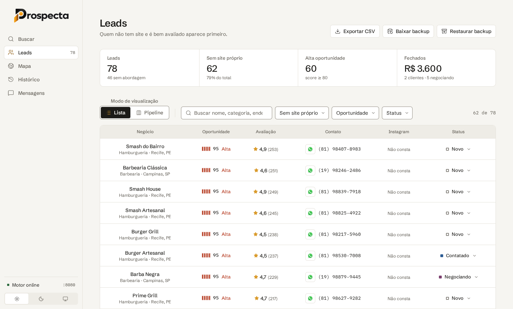
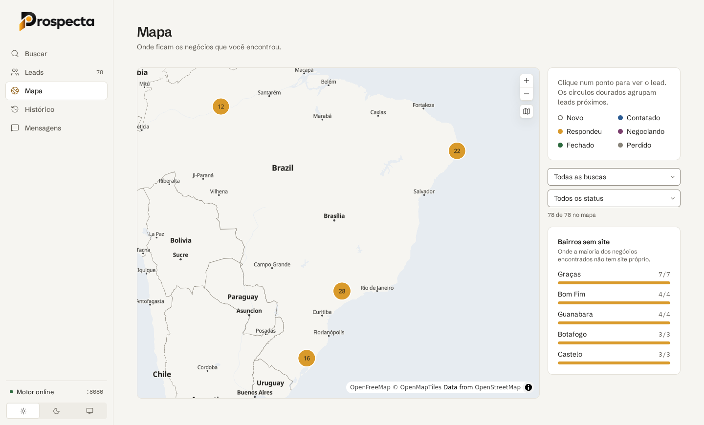
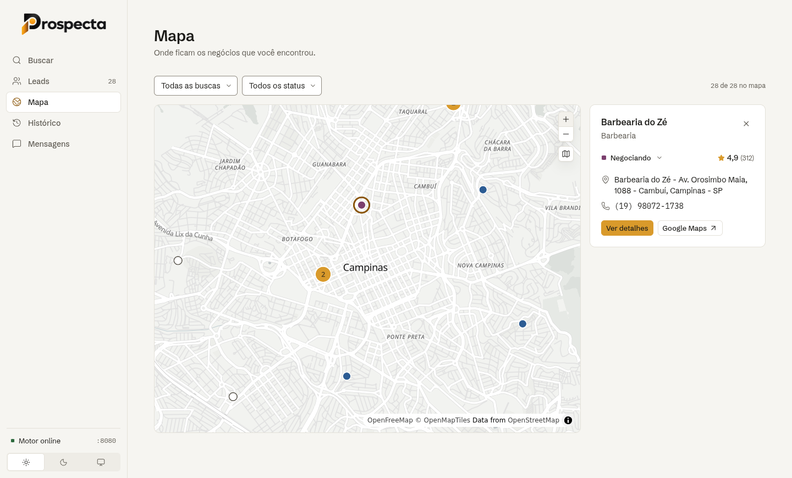
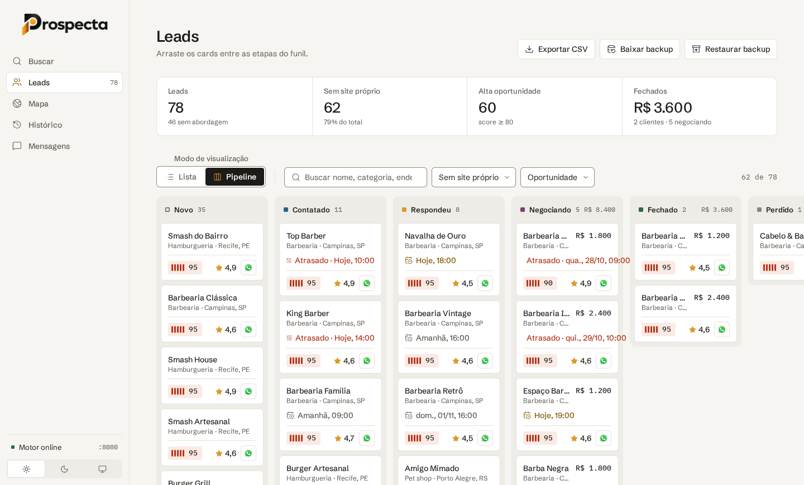
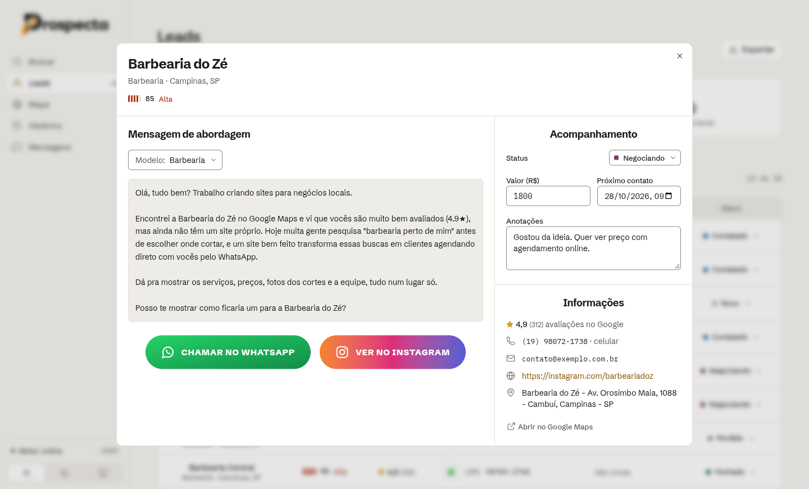
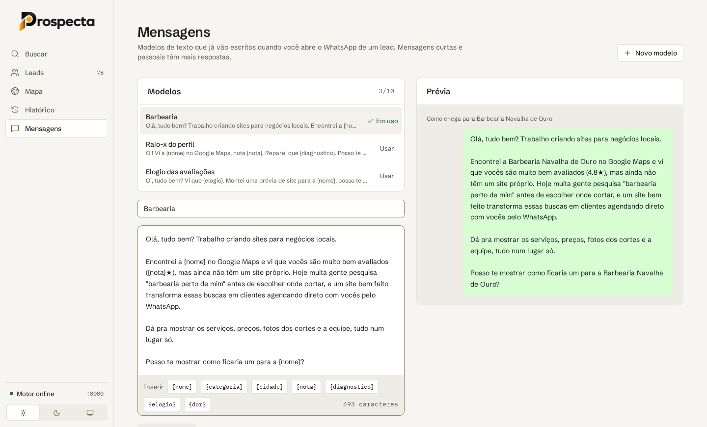

# Prospecta

**Ferramenta open source para encontrar clientes no Google Maps.** Você diz o nicho e a cidade ("barbearias em Campinas"), e o
Prospecta traz os negócios da região já ordenados por chance de virar cliente, com o botão de WhatsApp pronto para a abordagem.

<picture>
  <source media="(prefers-color-scheme: dark)" srcset="docs/images/leads-dark.png">
  
</picture>

<sub>Tela de Leads com dados de exemplo. O print acompanha o tema do GitHub (claro ou escuro).</sub>

Foi feito para quem vende **landing pages e sites** para negócios locais: quem **não tem site** (ou só tem Instagram/Linktree),
é bem avaliado e tem celular para WhatsApp aparece primeiro. Serve também para qualquer serviço vendido a pequenos negócios
(tráfego pago, social media, sistemas, fotografia…).

- **De graça e sem conta:** não precisa de chave de API, cadastro nem plano pago.
- **Roda no seu computador:** tudo sobe com um comando no Docker. Seus leads ficam só com você.
- **Código aberto:** licença [MIT](LICENSE). Use, estude, modifique.

> O Prospecta é um projeto de estudo e de uso pessoal, sem vínculo com o Google. Leia o [Aviso](#aviso) antes de usar.

## Sumário

- [Veja como é](#veja-como-é)
- [O que ele faz](#o-que-ele-faz)
- [Como rodar](#como-rodar)
- [Como usar](#como-usar)
- [Como funciona por dentro](#como-funciona-por-dentro)
- [Para quem quer contribuir](#para-quem-quer-contribuir)
- [Aviso](#aviso) · [Cuidados](#cuidados) · [Licença](#licença)

## Veja como é

Prints com dados de exemplo (barbearias). Eles acompanham o tema do GitHub, claro ou escuro.

### Mapa: onde estão os seus leads

De longe é um globo com as regiões em que você buscou. Cada círculo dourado agrupa os leads de uma região e mostra quantos são.

<picture>
  <source media="(prefers-color-scheme: dark)" srcset="docs/images/mapa-dark.png">
  
</picture>

Ao aproximar, vira mapa de ruas, com cada negócio colorido pela etapa do funil. Clique num ponto para ver o lead, mudar a etapa
ou abrir os detalhes.

<picture>
  <source media="(prefers-color-scheme: dark)" srcset="docs/images/mapa-rua-dark.png">
  
</picture>

### Pipeline: o funil de vendas

Arraste os cards entre Novo, Contatado, Respondeu, Negociando, Fechado e Perdido. Cada coluna soma o valor das propostas, e o
card avisa quando o próximo contato é hoje ou está atrasado.

<picture>
  <source media="(prefers-color-scheme: dark)" srcset="docs/images/pipeline-dark.png">
  
</picture>

### Detalhe do lead: a abordagem pronta

A mensagem já vem preenchida com o nome e a nota do negócio. Um clique abre o WhatsApp; ao lado, você registra a etapa, o valor
da proposta, o próximo contato e as anotações.

<picture>
  <source media="(prefers-color-scheme: dark)" srcset="docs/images/lead-detalhe-dark.png">
  
</picture>

### Mensagens: seus modelos de abordagem

Escreva até 10 modelos com as variáveis `{nome}`, `{categoria}`, `{cidade}`, `{nota}` e `{diagnostico}`, e veja na prévia como a
mensagem chega.

<picture>
  <source media="(prefers-color-scheme: dark)" srcset="docs/images/mensagens-dark.png">
  
</picture>

## O que ele faz

| Tela          | O que você faz nela                                                                      |
| ------------- | ---------------------------------------------------------------------------------------- |
| **Buscar**    | Escolhe nicho e cidade, dispara a busca e acompanha o andamento                          |
| **Leads**     | Vê os negócios encontrados em tabela ou no funil, filtra, abre os detalhes e exporta CSV |
| **Mapa**      | Vê onde fica cada negócio, num globo que vira mapa de ruas ao aproximar                  |
| **Histórico** | Revê as buscas feitas, abre os leads de cada uma ou apaga a busca                        |
| **Mensagens** | Escreve até 10 modelos de mensagem de abordagem, usados no botão de WhatsApp             |

Recursos principais:

- **Pontuação de oportunidade** de 0 a 100 para cada negócio, com o motivo de cada ponto (veja [a tabela](#a-pontuação)).
- **Funil de vendas (pipeline)** com as etapas Novo → Contatado → Respondeu → Negociando → Fechado / Perdido. É só arrastar o
  card; cada coluna soma o valor das propostas. Veja [o funil](#pipeline-o-funil-de-vendas).
- **Raio-x do perfil:** o que falta no perfil do negócio no Google (horário, foto, descrição, pedido online) e quantos
  concorrentes da mesma categoria, num raio de 2 km, já têm site. No mapa, os bairros com mais negócios sem site.
- **Acompanhamento por lead:** valor da proposta, data do próximo contato (com aviso de atrasado ou hoje) e anotações.
- **WhatsApp em um clique:** abre a conversa com a mensagem já preenchida com o nome, a nota e a cidade do negócio.
- **Mapa dos leads** num globo que vira mapa de ruas ao aproximar, com os pontos coloridos pela etapa do funil e agrupados
  por região. Veja [o mapa](#mapa-onde-estão-os-seus-leads).
- **Exportação em CSV** para planilha, que também serve de backup.
- **Tema claro e escuro**, e funciona no celular.

## Como rodar

### 1. Instale o Docker

O Prospecta roda dentro do [Docker](https://www.docker.com/), que já traz tudo o que ele precisa. Você não precisa instalar
Node, banco ou mais nada.

- **Windows:** instale o [Docker Desktop](https://www.docker.com/products/docker-desktop/). Se usar WSL, ative
  Settings → Resources → WSL Integration para a sua distro.
- **macOS:** instale o [Docker Desktop](https://www.docker.com/products/docker-desktop/).
- **Linux:** instale o [Docker Engine](https://docs.docker.com/engine/install/) com o plugin Compose.

Para conferir, rode `docker compose version` no terminal. Ele deve mostrar a versão.

### 2. Baixe o projeto

```bash
git clone https://github.com/probuled/prospecta.git
cd prospecta
```

Sem git, use **Code → Download ZIP** no GitHub e descompacte.

### 3. Suba o app

```bash
docker compose up -d --build
```

Na primeira vez ele baixa as imagens e faz o build, o que leva alguns minutos. Depois disso, abra **http://localhost:3000**.

| Serviço               | Endereço              |
| --------------------- | --------------------- |
| Prospecta (o app)     | http://localhost:3000 |
| Motor de scraping API | http://localhost:8080 |

### Comandos do dia a dia

```bash
docker compose up -d                         # liga de novo (depois de reiniciar o computador, por exemplo)
docker compose down                          # desliga tudo
docker compose logs -f google-maps-scraper   # mostra o que o motor está fazendo
git pull && docker compose up -d --build     # atualiza para a versão mais nova
```

Desligar ou atualizar **não apaga seus leads**: eles ficam no navegador (veja [Onde ficam os dados](#onde-ficam-os-dados)).

### Trocar as portas (opcional)

Se a porta 3000 ou 8080 já estiver em uso, copie o arquivo de exemplo e mude os valores:

```bash
cp .env.example .env
```

| Variável       | Padrão                  | Para quê                                                        |
| -------------- | ----------------------- | --------------------------------------------------------------- |
| `WEB_PORT`     | `3000`                  | Porta do app                                                    |
| `SCRAPER_PORT` | `8080`                  | Porta do motor                                                  |
| `SCRAPER_URL`  | `http://localhost:8080` | Endereço do motor usado pelo `npm run dev` (só desenvolvimento) |

As portas só aceitam conexões do próprio computador (`127.0.0.1`), porque nenhum dos serviços tem senha. **Não exponha o app na
internet** sem colocar um proxy com autenticação na frente.

### Problemas comuns

| Sintoma                               | O que fazer                                                                              |
| ------------------------------------- | ---------------------------------------------------------------------------------------- |
| O app mostra **"Motor parado"**       | O motor não está ligado. Rode `docker compose ps` e `docker compose up -d`               |
| Erro de **porta em uso** ao subir     | Troque `WEB_PORT` ou `SCRAPER_PORT` no `.env` ([acima](#trocar-as-portas-opcional))      |
| A busca não traz nada ou para no meio | O Google pode ter bloqueado seu IP por um tempo. Espere e faça buscas menores            |
| `docker: command not found` no WSL    | Ative a integração com o WSL no Docker Desktop e abra um terminal novo                   |
| A busca demora muito                  | É normal: o motor abre cada negócio no Maps. Escolha menos negócios nas opções avançadas |

## Como usar

### 1. Faça uma busca

Na tela **Buscar**, preencha o **nicho** ("Barbearias", "Dentistas"…) e a **cidade**. As sugestões abaixo do campo preenchem
nichos que costumam ter pouca presença online.

Em **Opções avançadas** você escolhe:

- **Quantidade de negócios:** 10, 20, 30, 60 ou 100. Quanto mais negócios, mais demorada a busca.
- **Coletar e-mails:** procura também o e-mail no site do negócio, quando ele tem site.

A busca roda em segundo plano. Você pode navegar pelo app enquanto ela anda, e o progresso aparece na tela Buscar. Quando
termina, os negócios viram leads.

### 2. Escolha quem abordar

Na tela **Leads**, os negócios aparecem ordenados pela pontuação, e por padrão só os que **não têm site próprio**. Dá para:

- buscar por nome, categoria ou endereço;
- filtrar por presença online (sem site, só rede social, tem site), oportunidade (alta, média, baixa), status no funil ou busca;
- alternar entre **tabela** e **funil**;
- **exportar CSV** do que está na tela.

Se o mesmo negócio aparecer em duas buscas, ele não duplica: os dados públicos são atualizados e o seu acompanhamento
(etapa, notas, valor, próximo contato) é mantido.

#### A pontuação

| Critério                              | Pontos |
| ------------------------------------- | -----: |
| Não tem site                          |     45 |
| Só tem rede social ou plataforma¹     |     35 |
| Nota 4.5 ou mais                      |     15 |
| 50 avaliações ou mais (negócio ativo) |     15 |
| De 10 a 49 avaliações                 |      5 |
| Telefone celular (provável WhatsApp)  |     15 |
| Tem e-mail                            |      5 |
| Perfil do Google sem horário ou foto  |      5 |

O total vai até 100 e define a faixa de oportunidade: **alta** com 80 ou mais, **média** de 50 a 79 e **baixa** abaixo de 50.

¹ Instagram, Facebook, Linktree, WhatsApp, TikTok, iFood, Google Sites, entre outros: não contam como site próprio.

### 3. Escreva sua mensagem

Na tela **Mensagens**, escreva seus modelos de abordagem (até 10). Use as variáveis abaixo, que são trocadas pelos dados de
cada negócio:

| Variável        | Vira                                                                             |
| --------------- | -------------------------------------------------------------------------------- |
| `{nome}`        | nome do negócio                                                                  |
| `{categoria}`   | categoria no Google Maps                                                         |
| `{cidade}`      | cidade                                                                           |
| `{nota}`        | nota no Google Maps (ex.: `4.8`)                                                 |
| `{diagnostico}` | o argumento do raio-x (ex.: `8 de 12 concorrentes num raio de 2 km já têm site`) |

As variáveis precisam estar **com chaves**, como na tabela. Os botões abaixo do texto inserem a variável onde está o cursor, e a
prévia ao lado mostra como a mensagem chega para um dos seus leads ([veja o print](#mensagens-seus-modelos-de-abordagem)).

### 4. Aborde e acompanhe

Abra um lead e clique no botão de **WhatsApp**: a conversa abre com a mensagem pronta, e você só revisa e envia. Se o negócio
tem Instagram, o botão ao lado abre o perfil. Na coluna da direita, registre a etapa, o **valor da proposta**, o **próximo
contato** e suas **anotações** ([veja o print](#detalhe-do-lead-a-abordagem-pronta)).

Na tela **Leads**, troque para **Pipeline** para ver o funil. Arraste os cards entre as etapas; cada coluna mostra quantos leads
tem e quanto somam as propostas. O card avisa quando o próximo contato é **hoje** ou está **atrasado**, e os números do topo
resumem quantos leads ainda não foram abordados e quanto já foi fechado ([veja o print](#pipeline-o-funil-de-vendas)).

### 5. Veja os leads no mapa

A tela **Mapa** mostra onde fica cada negócio. De longe é um **globo** com as regiões em que você buscou: cada círculo dourado
agrupa os leads de uma região e mostra quantos são. Clique num círculo, ou aproxime, e ele se abre em pontos com a cor da etapa
do funil ([veja os prints](#mapa-onde-estão-os-seus-leads)).

De perto, é um mapa de ruas. Clique num ponto para ver o lead, mudar a etapa ali mesmo ou abrir os detalhes. Dá para filtrar por
busca e por etapa, e o botão ao lado do zoom alterna entre globo e mapa plano.

Os leads salvos antes do mapa não guardaram a posição: use o botão **Localizar leads**, que relê a busca no motor e, se ela não
estiver mais lá, procura pelo endereço (mais lento e menos preciso).

### Onde ficam os dados

Leads, buscas e mensagens ficam **só no navegador** em que você usou o app (`localStorage`). Por isso:

- outro navegador ou computador começa vazio;
- limpar os dados do site, ou usar janela anônima, apaga tudo;
- **o único backup é exportar CSV** na tela Leads. Faça isso de vez em quando.

## Como funciona por dentro

Este repositório é **só o frontend**: não há backend próprio, banco de dados nem login.

```
Navegador (React)
  │  leads, buscas e modelos de mensagem → localStorage do navegador
  │
  ├─ /engine ──► proxy (nginx no Docker, Vite em dev)
  │                └─► gmaps-scraper :8080 — gosom/google-maps-scraper
  │
  ├─ nominatim.openstreetmap.org — transforma a cidade em coordenadas
  │
  └─ tiles.openfreemap.org — mapa de fundo da tela Mapa (OpenStreetMap, sem chave)
```

1. A cidade vira coordenadas pelo OpenStreetMap (Nominatim).
2. O app cria um job no motor (`POST /api/v1/jobs`) e confere o status a cada 5 segundos.
3. O motor, o [gosom/google-maps-scraper](https://github.com/gosom/google-maps-scraper), é um programa open source em Go que
   roda no container `gmaps-scraper`. Ele abre o Google Maps num navegador invisível, percorre os resultados e devolve um CSV.
   Não é uma IA e não é código deste projeto: é uma imagem Docker pronta, configurada como no
   [google-maps-scraper-kit](https://github.com/Mahanaicoach/google-maps-scraper-kit).
4. O CSV é limpo (incluindo a latitude e a longitude de cada negócio), cada lead recebe a pontuação
   (`src/domain/opportunity.ts`) e tudo é salvo no navegador.
5. A tela Mapa desenha os leads com o [MapLibre GL JS](https://maplibre.org/) sobre os tiles do
   [OpenFreeMap](https://openfreemap.org/), recoloridos com os tokens do tema.

O proxy `/engine` existe porque o motor não envia cabeçalhos CORS.

Um backend próprio só passa a ser necessário para sincronizar dados entre computadores ou pessoas, ter login, publicar o app na
internet, agendar buscas ou usar APIs com chave secreta. O [`CLAUDE.md`](CLAUDE.md) (seção 0) detalha cada caso.

## Para quem quer contribuir

### Stack

React 19 + TypeScript (strict), Vite, Tailwind CSS 4, React Router, shadcn/ui (Base UI), `lucide-react`, Papa Parse,
Vitest, oxlint + Prettier. Em produção, o build é servido por Nginx num container.

### Rodando com hot reload

Precisa de **Node.js 24** (versão no `.nvmrc`). O motor continua no Docker:

```bash
nvm use                                     # Node 24
npm ci                                      # instala e ativa os hooks do git (husky)
cp .env.example .env
docker compose up -d google-maps-scraper    # só o motor
npm run dev                                 # http://localhost:5173
```

### Scripts

| Comando                | O que faz                                  |
| ---------------------- | ------------------------------------------ |
| `npm run dev`          | servidor de desenvolvimento                |
| `npm test`             | testes de domínio e do parser              |
| `npm run typecheck`    | checagem de tipos                          |
| `npm run build`        | type-check e build                         |
| `npm run preview`      | serve o build localmente (com o `/engine`) |
| `npm run lint`         | oxlint                                     |
| `npm run format`       | formata o projeto com Prettier             |
| `npm run format:check` | confere a formatação (usado na CI)         |

Antes de abrir um PR: `npm run lint && npm run typecheck && npm test && npm run build`.

### Arquitetura

```
src/
  domain/                regras de negócio puras (lead, funil, pontuação, telefone, presença online)
  application/           portas (interfaces) e casos de uso: StartSearch, SyncSearch, DeleteSearch, LocateLeads
  infrastructure/        adaptadores: API do motor, Nominatim, OpenFreeMap, localStorage, exportação CSV
  app/                   composition root (container.ts), providers e rotas
  presentation/          páginas, layout e hooks React
  components/prospecta/  componentes do design system (Button, Select, Score, Status, …)
  components/ui/         primitivos do shadcn ainda usados (sheet, dialog, checkbox, toasts)
```

As dependências apontam para dentro: a apresentação usa casos de uso, que dependem só de interfaces. Trocar o `localStorage`
por um banco, ou o motor por outra API, é escrever um novo adaptador e registrá-lo em `src/app/container.ts`.

### Design system

A fonte da verdade é `design-system/prospecta-design-system/prospecta-design-system/README.md` (princípios, voz, cor,
tipografia, componentes e o que evitar).

- Tokens em `src/index.css`, gerados de `tokens.css`. Tema via `data-theme="light|dark"` no `<html>`.
- A paleta padrão do Tailwind está desligada: só existem as cores do sistema (`bg-surface`, `text-ink-muted`, `border-line`,
  `bg-ouro`, …). Use sempre o token, nunca o hex.
- Fontes (Schibsted Grotesk e IBM Plex Mono) e logos oficiais em `src/assets/`.

### Fluxo de trabalho

Git Flow, Conventional Commits, PRs, versão e travas automáticas estão no [`CLAUDE.md`](CLAUDE.md). As mudanças de cada versão
ficam no [`CHANGELOG.md`](CHANGELOG.md).

## Aviso

O Prospecta é um projeto de estudo e de uso pessoal. Ele não tem vínculo com o Google, e o código vem "como está", sem garantia
(veja a [licença](LICENSE)). Quem roda o projeto é o único responsável pelo uso que faz dele: respeitar os termos de uso do
Google, a LGPD e as regras do WhatsApp cabe a quem usa, não aos autores.

## Cuidados

- Raspar o Google Maps vai contra os termos de uso do Google. Use com moderação: uma busca por vez e poucos negócios. Se
  exagerar, o Google bloqueia seu IP temporariamente (sua conta Google não é afetada).
- Telefones e e-mails são dados pessoais (LGPD). Faça abordagens individuais e respeite quem pedir para não ser contatado.
- Disparo em massa pode banir seu número no WhatsApp. O botão abre uma conversa por vez: revise antes de enviar.

## Licença

[MIT](LICENSE) © 2026 Luan Costa. O motor [gosom/google-maps-scraper](https://github.com/gosom/google-maps-scraper) é um
projeto à parte, com licença própria (também MIT).
